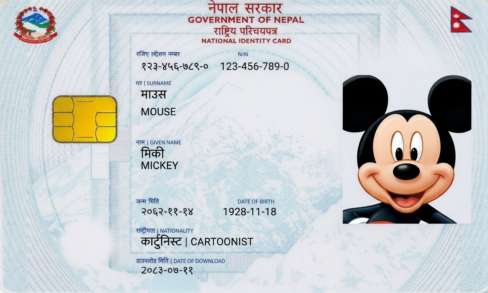
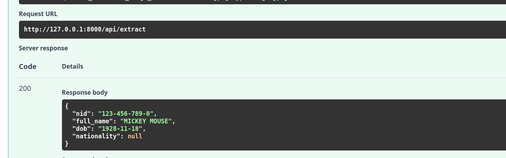

# Nepali NID OCR

An OCR-based document processing system designed to extract structured information from Nepal's National Identity Cards (NID). The project uses PaddleOCR, OpenCV, and Python to recognize Nepali and English text, process document images, and extract important identity information.

## Features

- **Image Processing:** Loads and processes document images using OpenCV.
- **Perspective Correction:** Corrects document perspective before OCR processing.
- **OCR Integration:** Supports PaddleOCR and Tesseract.
- **Multilingual Recognition:** Recognizes Nepali (Devanagari) and English text using PaddleOCR.
- **Layout Detection:** Identifies supported NID layouts.
- **Text Extraction:** Extracts structured information from recognized OCR text.
- **Fuzzy Matching:** Handles OCR recognition errors in field labels using RapidFuzz.
- **REST API:** Provides an image upload endpoint using FastAPI.

## Technologies Used

| Technology | Purpose |
|---|---|
| Python | Core programming language |
| PaddleOCR | Text recognition |
| Tesseract OCR | Alternative OCR engine |
| OpenCV | Image processing and perspective correction |
| NumPy | Image array processing |
| RapidFuzz | Fuzzy text matching |
| FastAPI | REST API development |
| Uvicorn | ASGI server |

## Project Structure

```text
FrontNIDOCR/
│
├── app/
│   ├── api/
│   │   ├── main.py
│   │   └── routes.py
│   │
│   ├── detection/
│   │   ├── fuzzy_matcher.py
│   │   ├── layout_detector.py
│   │   └── text_extractor.py
│   │
│   ├── ocr/
│   │   ├── ocr_pipeline.py
│   │   ├── paddle_engine.py
│   │   └── tesseract_engine.py
│   │
│   └── preprocessing/
│       ├── image_loader.py
│       ├── orientation.py
│       └── perspective.py
│
├── images/
├── config.py
├── main.py
├── requirements.txt
└── README.md
```

## Installation

### 1. Clone the repository

```bash
git clone https://github.com/shresthanischal7/nepali-nid-ocr.git
cd nepali-nid-ocr
```

### 2. Create a virtual environment

```bash
python3 -m venv paddle_env
```

Activate it:

**Linux/macOS:**
```bash
source paddle_env/bin/activate
```

**Windows:**
```bash
paddle_env\Scripts\activate
```

### 3. Install dependencies

```bash
pip install -r requirements.txt
```

PaddleOCR may download its required recognition and detection models during initialization.

### 4. Install Tesseract (optional)

Tesseract is used as an alternative OCR engine.

On Ubuntu:

```bash
sudo apt install tesseract-ocr
```

For Nepali language recognition:

```bash
sudo apt install tesseract-ocr-nep
```

## Running the Project

### Run the OCR application

```bash
python main.py
```

### Run the FastAPI server

```bash
uvicorn app.api.main:app --reload
```

Once the server starts, open:

**API Documentation:** http://127.0.0.1:8000/docs

## API Usage

### Extract NID Information

**Endpoint:**

```http
POST /api/extract
```

Upload an image using the `file` form-data field.

The API processes the uploaded image and returns the extracted information as JSON.

### Example Response

```json
{
  "nid": "123-456-789-0",
  "full_name": "PRITHVI NARAYAN SHAH",
  "dob": "1723-01-07",
  "nationality": "Nepali"
}
```

*The response is illustrative. Actual results depend on image quality and OCR recognition accuracy.*

## Current Development Status

- [x] Image loading
- [x] Perspective correction
- [x] PaddleOCR integration
- [x] English and Nepali text recognition
- [x] Fuzzy matching for OCR labels
- [x] Initial NID field extraction
- [x] FastAPI endpoint implementation
- [x] Support for different NID layouts
- [ ] Tesseract integration

## Screenshots

### Sample


### Result



## Disclaimer

This project is intended for educational and development purposes. OCR results may contain recognition errors and should be verified against the original document.

Do not upload real identity documents or sensitive personal information to public repositories or unsecured environments.

## Author

**Nischal Shrestha**

GitHub: [@shresthanischal7](https://github.com/shresthanischal7)
